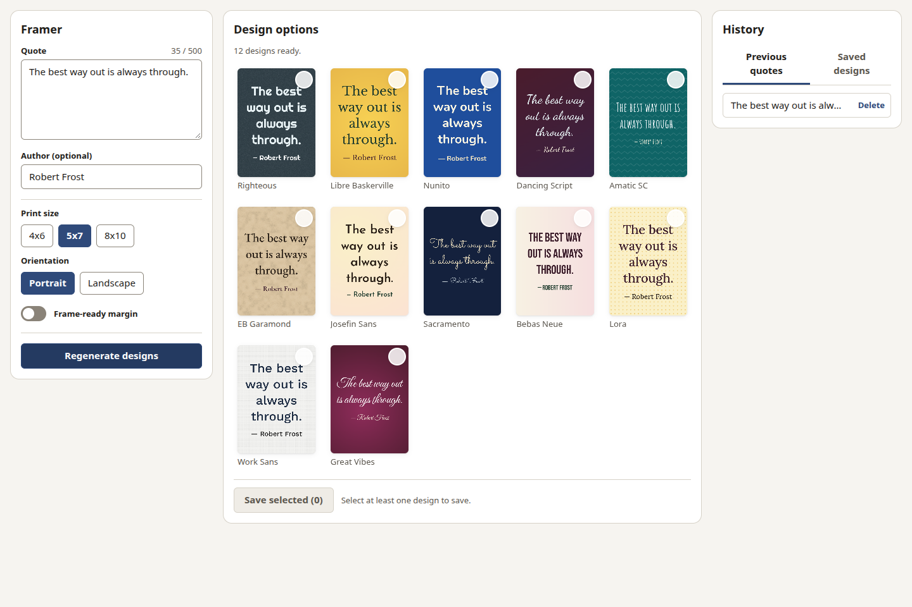
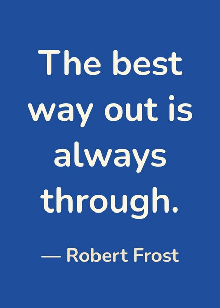
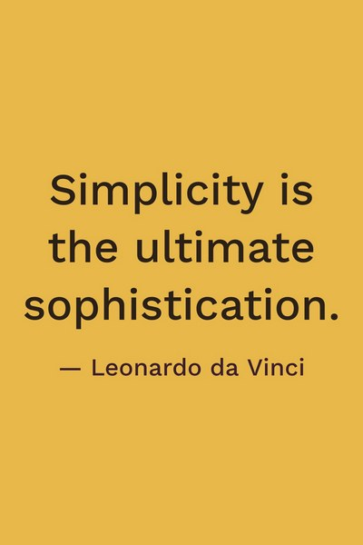
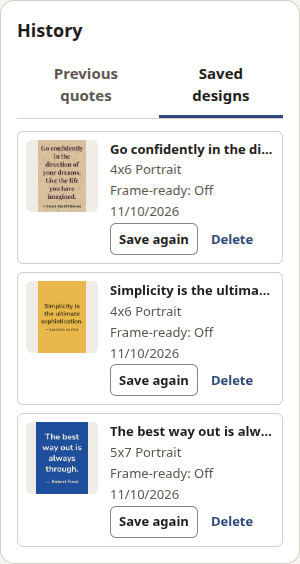

# Framer

Framer turns an inspirational quote into print-ready JPEGs for retail photo centers.

Type a quote (and, if you like, who said it) and press **Generate designs**. Framer shows 12 rendered
designs, each pairing a different typeface with a different background, all with legible contrast.
Pick one or more and save exact-size, 300 PPI JPEGs (4x6, 5x7, or 8x10, portrait or landscape, with an
optional frame-ready margin) to `Pictures/Framer`. Previous quotes and saved designs are kept in a local
history, and any saved design can be saved again byte for byte.

It is an Electron desktop app for Linux, macOS, and Windows. It works fully offline.



## What it does

Framer is for anyone who wants a favorite quote on the wall without opening a design tool. You bring the
words; Framer does the typesetting:

- **Twelve designs at a time.** Each pairs one of the bundled open-licensed typefaces with a background
  (solid colors, gradients, paper and linen textures, patterns), and every pairing is checked for readable
  contrast. Don't like any? **Regenerate designs** for twelve more.
- **What you see is what you print.** Previews are the real print rendered at full resolution and scaled
  down, and the text layout fits the quote to the page.
- **Ready for the photo counter.** Saved files are exact-size JPEGs at 300 PPI for 4x6, 5x7, or 8x10,
  portrait or landscape. An optional frame-ready margin keeps the words clear of a mat or frame lip.
- **Nothing is lost.** Previous quotes and saved designs stay in a local history, and **Save again**
  re-exports any design byte for byte.

These prints came straight out of the app (scaled down for this page):

<p>
  
  
  
  
</p>

To refresh these images after a UI change, run `npm run build && npm run screenshots`.

## Prerequisites

- Node **24** (`nvm use` reads `.nvmrc`) and npm.

## Develop

```bash
npm ci
npx playwright install chromium   # used by the render and E2E tests
npm run dev                       # the app with hot reload
```

**VS Code**: press **F5** and choose **Debug App (Main + Renderer)**. Breakpoints work in `src/main`,
`src/preload`, and `src/renderer`. There are also launch configurations for Vitest (current file, all
unit tests) and Playwright.

Environment overrides, useful for testing and debugging:

| Variable               | Effect                                                                     |
| ---------------------- | -------------------------------------------------------------------------- |
| `FRAMER_USER_DATA_DIR` | Where `library.json` and saved designs live (default: Electron `userData`) |
| `FRAMER_EXPORT_DIR`    | Where saved JPEGs go (default: `<Pictures>/Framer`)                        |
| `FRAMER_DISABLE_GPU=1` | Turns off GPU acceleration if a driver misbehaves                          |

## Test

```bash
npm run lint && npm run typecheck
npm test                 # unit tests (Node and jsdom)
npm run test:render      # real-Chromium canvas tests (Vitest browser mode)
npm run test:coverage    # unit + render with the coverage gate
npm run test:e2e         # builds, then drives the Electron app with Playwright (+ axe); headless on Linux
npm run test:all         # all of the above
npm run fonts:verify     # every font has its file and its OFL license
```

On Linux the E2E tests run Electron headless (Chromium's Ozone headless platform): no windows open and no
display server is needed. To watch them, run `FRAMER_E2E_HEADED=1 npm run test:e2e`. On macOS and Windows
they open real windows.

Coverage thresholds in `vitest.config.ts` only go up: a run that beats one raises it, and CI fails if the
raised value isn't committed.

**Linux sandbox note**: on Ubuntu 23.10+ AppArmor blocks Electron's sandbox for unprivileged users, and
Electron aborts with a "SUID sandbox helper" error. For local runs either set `ELECTRON_DISABLE_SANDBOX=1`
(development only) or allow user namespaces with
`sudo sysctl -w kernel.apparmor_restrict_unprivileged_userns=0`. CI does the latter.

## Release

1. Bump `version` in `package.json`, commit, and merge to `main`.
2. Create a GitHub Release tagged `v<version>` and publish it.
3. `.github/workflows/release.yml` builds Linux (AppImage, deb), Windows (NSIS), and macOS (dmg, zip;
   arm64 and x64) and attaches them to the release. Builds are unsigned unless signing secrets are set.

The full validation checklist, including the photo-center acceptance check, is in
[specs/001-quote-print-designer/quickstart.md](specs/001-quote-print-designer/quickstart.md).

## How it is built

- `src/shared` — pure TypeScript domain: zod schemas, print-size math, quote rules, file names, and the
  IPC contract.
- `src/engine` — the rendering engine: font and background catalogs, the style generator, text layout,
  background painters, and the render services (a Web Worker in the app, the main thread in tests).
  Previews are the print rendered at full resolution and reduced, so what you see is what you save.
- `src/main` — the Electron main process: library storage (atomic JSON writes), saving and exporting
  designs, and the IPC handlers.
- `src/preload` — the narrow `window.framer` bridge.
- `src/renderer` — the React UI.

Design documents live in [specs/001-quote-print-designer](specs/001-quote-print-designer). A future
AI-generated background seam (`ImageGenerator`) is described in
[contracts/engine.md](specs/001-quote-print-designer/contracts/engine.md); it is documented only and not
part of v1.

## Fonts

All bundled fonts are licensed under the SIL Open Font License 1.1, which allows using them in printed
images. Each family's license is in `assets/fonts/<family>/OFL.txt`, and `assets/fonts/fonts.manifest.json`
lists every face. Color emoji come from Noto Color Emoji (OFL).
